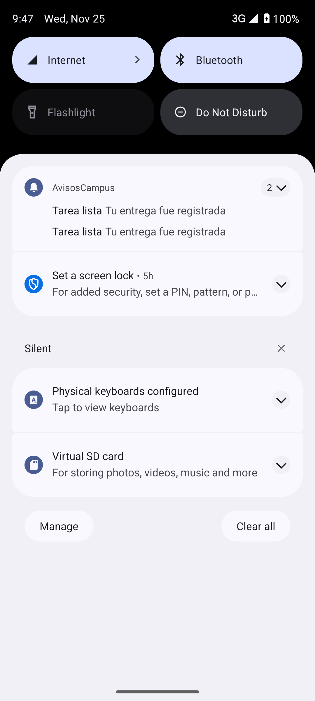
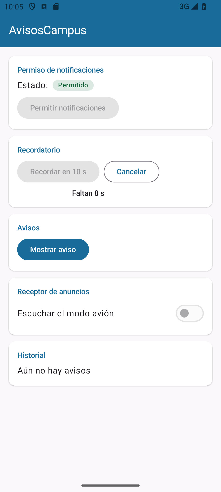
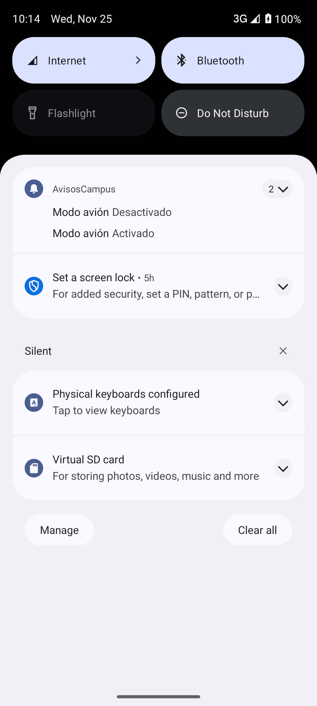
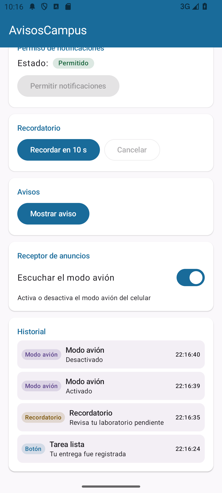
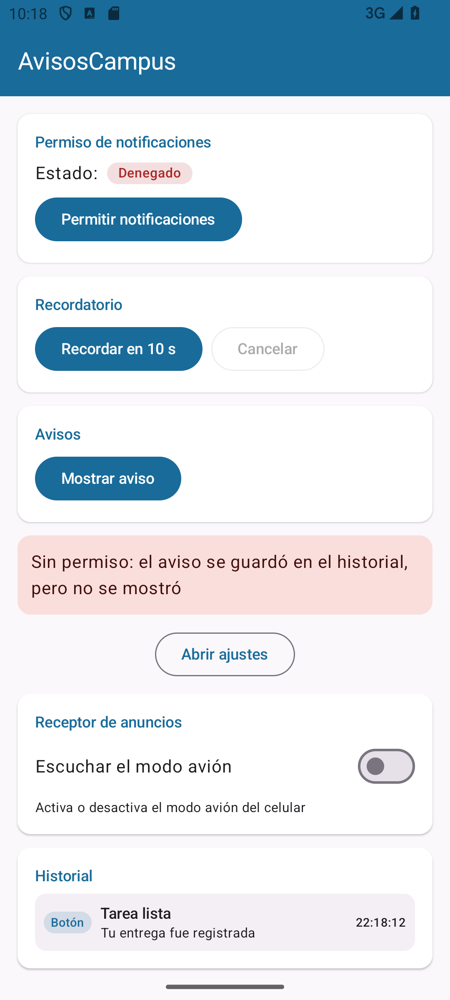

# AvisosCampus

Aplicación Android en Kotlin, Jetpack Compose y Material 3. Publica avisos locales, programa un recordatorio de 10 segundos y escucha los cambios del modo avión. El historial guarda los avisos en memoria y muestra los 20 más recientes. La app usa datos ficticios.

## Ejecutar la app

1. Abre el proyecto en Android Studio con el SDK de Android 35 y selecciona JDK 17 o 21 para Gradle.
2. Sincroniza Gradle y ejecuta el módulo `app`. Usa un emulador con Android 13 o superior para probar el diálogo de permiso.
3. Pulsa **Permitir notificaciones**. Si el permiso se deniega, el aviso se guarda en el historial y la app ofrece **Abrir ajustes**.

## Estructura de paquetes

```text
com.garcia.avisoscampus/
├── AvisosApp.kt
├── MainActivity.kt
├── data/
│   └── AvisosRepository.kt
├── model/
│   └── Modelos.kt
├── notificacion/
│   └── Notificador.kt
├── receiver/
│   └── ModoAvionReceiver.kt
├── ui/
│   ├── HistorialAvisos.kt
│   ├── PantallaAvisos.kt
│   └── theme/
│       └── Theme.kt
└── viewmodel/
    ├── AvisosViewModel.kt
    └── AvisosViewModelFactory.kt
```

## Arquitectura MVVM

```text
PantallaAvisos ── acciones de usuario y modo avión ──► AvisosViewModel
AvisosViewModel ── registra avisos ──► AvisosRepository ──► AvisosRepositoryMemoria
AvisosRepository ── StateFlow del historial ──► AvisosViewModel
AvisosViewModel ── StateFlow y SharedFlow ──► PantallaAvisos
PantallaAvisos ── solicita la publicación ──► Notificador ──► Android
```

La pantalla registra el receptor mientras el interruptor está encendido y lo desregistra en `onDispose`. El `ViewModel` decide qué aviso registrar y emite el evento que la pantalla usa para publicar la notificación. Así puede probarse la lógica del aviso sin un `Context`.

## Capturas

| Notificación | Recordatorio | Modo avión | Historial | Permiso denegado |
| --- | --- | --- | --- | --- |
|  |  |  |  |  |

## Pruebas de aceptación

Verificadas en un emulador con Android 14 (API 34).

| Prueba | Resultado |
| --- | --- |
| Abrir los ajustes de notificaciones de AvisosCampus | Aparece el canal **Avisos** después de conceder el permiso. |
| Pulsar **Permitir notificaciones** | Aparece el diálogo de Android y la etiqueta refleja la respuesta. |
| Pulsar **Mostrar aviso** | Aparece **Tarea lista** en el panel. |
| Pulsar **Mostrar aviso** dos veces | Aparecen dos notificaciones con IDs distintos. |
| Tocar un aviso | Se abre la app y el aviso desaparece. |
| Iniciar **Recordar en 10 s** | Aparece la cuenta regresiva y se publica **Recordatorio** al terminar. |
| Minimizar durante la cuenta | El recordatorio se publica igual. |
| Cancelar durante la cuenta | Desaparece el contador y no se publica un aviso. |
| Cambiar el modo avión con la escucha activada | Aparecen los avisos **Activado** y **Desactivado**. |
| Cambiar el modo avión con la escucha apagada | No se publica un aviso nuevo. |
| Denegar el permiso y pulsar **Mostrar aviso** | El aviso queda en el historial, aparece el mensaje y la app sigue abierta. |
| Rotar durante el recordatorio | La cuenta continúa. |
| Revisar la arquitectura | El `ViewModel` mantiene la lógica de estado y la pantalla desregistra el receptor en `onDispose`. |

## Para pensar

1. **¿Por qué hacen falta un canal y un permiso?** El canal permite configurar la importancia y el comportamiento de una categoría en Ajustes. Desde Android 8, una app orientada a esa versión o superior debe registrar el canal antes de publicar. Desde Android 13, si el usuario no concede el permiso, Android bloquea los avisos de esta app. [Guía de notificaciones de Android](https://developer.android.com/develop/ui/compose/notifications/create-notification)
2. **¿Por qué el `ViewModel` emite un evento?** Porque decide qué avisar y lo registra en el repositorio. La pantalla recibe el evento y llama a `Notificador` con el `Context`, lo que mantiene la lógica del `ViewModel` independiente de las API de notificaciones.
3. **¿Qué ocurre si se repite un ID?** Si el aviso anterior sigue activo y se usa el mismo ID y la misma etiqueta, Android lo reemplaza con los datos del nuevo. Los IDs distintos permiten que ambos aparezcan en el panel. [Referencia de `NotificationManager`](https://developer.android.com/reference/android/app/NotificationManager)
4. **¿Por qué `onReceive` debe ser corto y hay que desregistrar el receptor?** En esta app, Android entrega la llamada en el hilo principal. Un trabajo largo puede bloquear la interfaz. Desregistrar el receptor evita retener la actividad y recibir cambios después de que la pantalla deje de escucharlos. [Guía sobre anuncios del sistema](https://developer.android.com/develop/background-work/background-tasks/broadcasts)
5. **¿Cuándo usar una notificación local o una push de Firebase?** Una local encaja si el aviso nace en el dispositivo, como el recordatorio de esta app. Una push de Firebase Cloud Messaging encaja cuando el evento nace en un servidor, como un cambio de horario que debe llegar a varios dispositivos. [Documentación de Firebase Cloud Messaging](https://firebase.google.com/docs/cloud-messaging)
